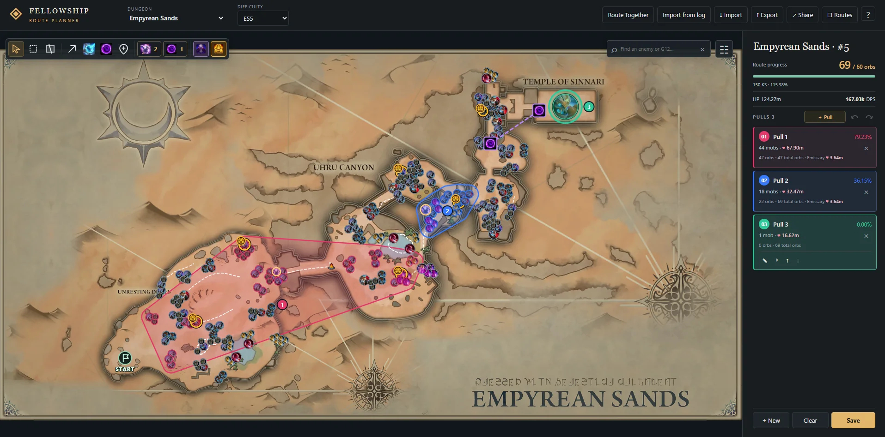

# Fellowship Route Planner

Dungeon route planner for Fellowship.

[https://olegfellow.dev](https://olegfellow.dev)



- Maps and dungeon data sourced directly from the game.
- Route Together: plan routes with your team in real time.
- Import routes from Fellowship Logs reports.
- View pack efficiency, total route HP, patrol paths, and completion percentage.
- Routes are stored locally in your browser and can be exported or shared via links.

Run locally (requires Node.js and npm):

```sh
npm ci
npm run dev
```

Open [localhost:4173](http://localhost:4173/).
